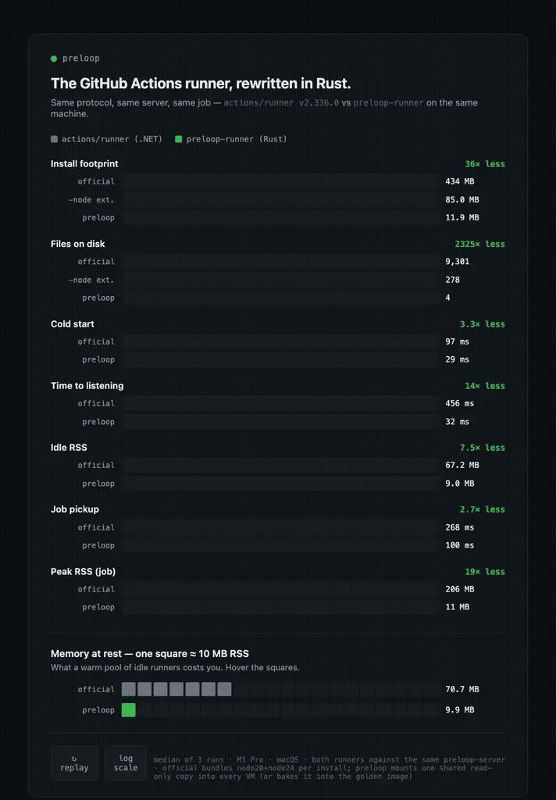

# preloop


> A failed step, a fix in another pane, and a re-run, all local, with no push required.


preloop is a local, self-hosted equivalent of GitHub Actions. The engine (`preloop serve`) accepts workflows the same way GitHub does: `${{ }}` expressions, matrix builds, reusable workflows, concurrency groups, OIDC etc. It executes them on hardware-isolated microvms that work on Windows/macOS or Linux, and resume in 300ms. Your `.github/workflows` run unmodified, and you can run CI against your uncommitted changes(respects .gitignored/untracked ones).


It speaks the official `actions/runner` protocol, so you can use the official runner to register, poll, execute, and report against it without GitHub-hosted minutes. You can also use our Rust runner, which installs 36× smaller and peaks at 19× lower memory (see benchmarks below).

Preloop doesn't rely only on GitHub Webhooks to update the status of the CI. We run a Webhook watchdog that detects drift, and reconciles your commits with received webhooks against the GitHub API. You can run your committed changes and run workflows locally and pass `--push` or `--create-pr` to open a PR with the checks correctly updated (new PRs open as drafts by default, see `--pr-draft`). This can be useful if/when GitHub's webhook service is down.

## Quick start

```sh
# Install (macOS/Linux), any one of:
brew install preloopdev/tap/preloop   # Homebrew
npm install -g @preloop-dev/cli       # npm, downloads the same release binaries
mise use -g github:preloopdev/preloop # mise, downloads the same release archive

# Or fetch the installer at a release tag, read it, then run it. It downloads
# the release binaries and verifies the sha256 of each one.
ver=v0.34.0   # latest release, others at https://github.com/preloopdev/preloop/releases
curl -fsSL "https://raw.githubusercontent.com/preloopdev/preloop/$ver/install.sh" -o install.sh
less install.sh
sh install.sh
```
```
preloop init              # wizard: credentials, golden image, how to run
preloop serve            # engine on 127.0.0.1:9090
```
```
cd my-repo
preloop run -f .github/workflows/ci.yml --event pull_request
```
`preloop init` is a short setup wizard. It sets up your GitHub credential,
picks the VM image your jobs run in, and chooses how the engine runs, then
writes `~/.preloop/config.toml`. Without a terminal it takes the same answers
as flags. Every flag is in the [`init` reference](docs/cli_reference.md#preloop-init-options).

`preloop serve` runs in the foreground. Add `-d` to detach it.

The first run downloads the default VM image, a packed copy of the official
GitHub runner image ([runner-image-blobs](https://github.com/preloopdev/runner-image-blobs)),
and builds a local "golden" VM from it. That takes a few minutes. The image is
about 9 GB compressed and almost 50 GB unpacked, so keep at least 80 GB of disk
free. Every job then forks from the golden VM in about 300 ms. Each VM uses
only the memory its job needs, and the idle engine takes about 25 MB. To use
your own image, point `init` at an OCI image; see [docs/vm-images.md](docs/vm-images.md).

Prefer not to run a script? Download `preloop-cli-<target>.tar.gz` and its
`.sha256` from the [latest release](https://github.com/preloopdev/preloop/releases/latest),
check the checksum, put `preloop` on your `PATH`, and run `preloop update` to
install the pinned SmolVM runtime. Release assets also carry build provenance:
`gh attestation verify <asset> --repo preloopdev/preloop`. MicroVM jobs also
need the Linux guest runner at `<prefix>/lib/preloop/runner/<triple>/preloop-runner`.
`install.sh` installs it, and [docs/self-hosting.md §3](docs/self-hosting.md)
has the manual commands.

On Apple Silicon, x86_64 goldens run through Rosetta 2 at close to native
speed. Prefer arm64 goldens when you can. Known limits are in
[docs/fidelity-gap.md](docs/fidelity-gap.md).

You can simulate most if not all GitHub events locally. For some events, you might need to add a payload.
See [docs/cli_reference.md](docs/cli_reference.md) for more flags you can pass.

To continue with the setup, see GitHub App and PAT credentials, secrets, config file, and the troubleshooting guide: [docs/setup.md](docs/setup.md)

Run it as a server, service install, every runtime knob, and how to expose it (tailnet only, Tailscale Funnel, Cloudflare Tunnel, or your own
domain): [docs/self-hosting.md](docs/self-hosting.md)

### Just the runner

`preloop-runner` is a drop-in Rust replacement for `actions/runner`. It
registers against GitHub (or a preloop server) the same way, with a 36×
smaller install and 19× lower peak memory:

```sh
# Fetch the installer at a release tag, read it, then run it with --runner.
ver=v0.34.0   # latest release; --runner needs v0.33.7 or newer
curl -fsSL "https://raw.githubusercontent.com/preloopdev/preloop/$ver/install.sh" -o install.sh
less install.sh
sh install.sh --runner
export PATH="$HOME/.local/bin:$PATH"
preloop-runner configure --url https://github.com/owner/repo --token <registration-token>
preloop-runner run
```

Every release also publishes standalone binaries for Linux (x86_64/aarch64),
macOS (x86_64/arm64), and Windows (x86_64), each with a CycloneDX SBOM
(`preloop-runner_<triple>.cdx.json`) and a sha256 checksum:

```sh
curl -fsSLO https://github.com/preloopdev/preloop/releases/latest/download/preloop-runner-<triple>
chmod +x preloop-runner-<triple>
./preloop-runner-<triple> configure --url https://github.com/owner/repo --token <registration-token>
./preloop-runner-<triple> run
```

Or use the container image with a persistent volume:

```sh
docker run --rm -v preloop-runner-data:/runner \
  ghcr.io/preloopdev/preloop-runner:latest \
  --runner-root /runner configure --url … --token … --unattended
docker run --rm -v preloop-runner-data:/runner \
  ghcr.io/preloopdev/preloop-runner:latest \
  --runner-root /runner run
```

Details: [docs/setup.md](docs/setup.md#just-the-runner-standalone-github-actions-runner).

## What makes it different vs others.

- We use the real runner protocol, not a behavior approximation: the official runner binary works against it unchanged.
- Hardware-isolated microvms for each job that spin up in 300ms, elastically scale up and down, and cross-platform.
- GitHub App and fine-grained PAT support with per-job token minting so your checks get updated.
- DAP-powered job inspection: attach at entry, inspect live GitHub/job context, pause, and continue, and allow for step-level retries. 
- Heavily tested with property tests, differential tests, and formal verification. Conformance is table-stakes. 
- NDJSON event output for agents and developer tooling.

For a more detailed comparison of how we compare, please see: [docs/preloop_vs_others.md](docs/preloop_vs_others.md)


### Agent-driven debugging

When a run is submitted with the DAP debugger enabled, preloop holds the job at entry until a debugger attaches. An agent or compatible DAP client can then inspect the live `github`, `env`, `runner`, `job`, `steps`, and `secrets`
scopes before continuing the job. This is useful when the workflow YAML looks
right but the runtime event payload, matrix values, or generated context is
wrong.


```sh
preloop dap <run-id>
```

## Benchmarks

`preloop-runner` is a from-scratch Rust reimplementation of `actions/runner`
that speaks the same protocol — the official runner works against preloop
unchanged, and preloop-runner registers against GitHub the same way. Same
server, same job, measured on the same machine (M1 Pro, macOS, median of 3):



| Metric | actions/runner 2.336.0 | preloop-runner | |
|---|---|---|---|
| Install footprint | 434 MB · 9,301 files | 11.9 MB · 4 files | 36× |
| Runner code only | 85 MB | 11.9 MB | 7× |
| Cold start | 97 ms | 29 ms | 3.3× |
| Time to listening | 456 ms | 32 ms | 14× |
| Idle RSS | 67 MB | 9 MB | 7.5× |
| Warm pool ×10 idle | 672 MB | 90 MB | 7.5× |
| Job pickup | 268 ms | 100 ms | 2.7× |
| Peak RSS during a job | 206 MB | 11 MB | 19× |

The official tarball bundles node20 + node24 (~350 MB) into every install;
preloop-runner ships as a single binary and mounts one shared read-only copy
of the externals into every VM (or bakes them into the golden image). A warm
pool of 10 idle runners costs ~90 MB instead of ~670 MB.


Reproduce: `scripts/bench-runner-compare.sh` (set `BENCH_RUNS=N`; needs
`target/release/preloop-runner` and the official runner in
`~/.cache/actions-runner/current`). Interactive chart:
`benchmarks/runner-compare.html`.

## Documentation on where to go to find info.

| Topic | Doc |
|---|---|
| Setup, credentials, secrets, config | [docs/setup.md](docs/setup.md) |
| CLI reference | [docs/cli_reference.md](docs/cli_reference.md) |
| Hosting it yourself: service install, knobs, exposure | [docs/self-hosting.md](docs/self-hosting.md) |
| VM images, version pins, and custom goldens | [docs/vm-images.md](docs/vm-images.md) |
| GitHub App webhooks and check runs | [docs/github-app-webhook.md](docs/github-app-webhook.md) |
| Job tokens, minting, OIDC | [docs/github-tokens.md](docs/github-tokens.md) |
| Debug sessions (pause, inspect, retry) | [docs/debug-sessions.md](docs/debug-sessions.md) |
| Pre-push checks for coding agents | [docs/agent-pre-push.md](docs/agent-pre-push.md) |
| Architecture and crate map | [docs/architecture.md](docs/architecture.md) |
| Protocol conformance | [docs/conformance.md](docs/conformance.md) |
| Fidelity gaps and roadmap | [docs/fidelity-gap.md](docs/fidelity-gap.md) |
| Contributing and CI requirements | [CONTRIBUTING.md](CONTRIBUTING.md) |

## License

Two licenses, one project:

- **Everything except the control plane is MIT** — the CLI, the Rust runner,
  the parser/expression/protocol crates, the VM orchestrator, and the docs.
- **The control plane (`preloop serve` / `preloop-runner-server`) is
  FSL-1.1-MIT** so source-available. You may use, modify, and redistribute it
  for any non-competing purpose (internal CI, commercial products, forks),
  and it converts to MIT on the second anniversary of each release. What
  "non-competing" means: you can't offer it as a hosted CI *service* that
  competes with preloop's own offering.

Full terms: `crates/preloop-runner-server/LICENSE` (FSL-1.1-MIT) and MIT for
the rest.

## Credits

This project wouldn't especially be possible without:

- [smolvm] — the microVM runtime every job executes in
- [runner.server] — the protocol reverse-engineering this project builds on

[smolvm]: https://github.com/smol-machines/smolvm
[runner.server]: https://github.com/ChristopherHX/runner.server
