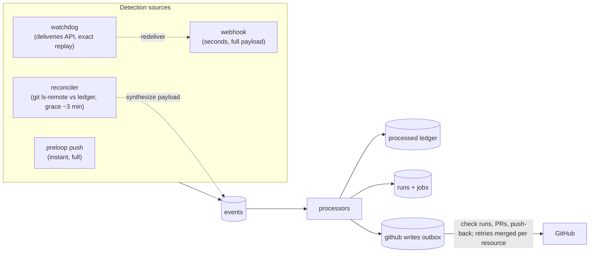

# GitHub resiliency

Status: **design — PR 0, no code yet.** Written against `public/main` @
`4831f828`, then re-verified against `public/main` @ `85e1fa168` (2026-10-18).
Merged work that narrowed a failure shape or fixed a root cause is called out
inline, and the remaining roadmap is stated against that revision. Line anchors
are approximate once the code moves; file anchors are relative to
`crates/preloop-runner-server/src/` (so `control/lite/schema.sql` means
`src/control/lite/schema.sql`) unless they name another path. Load-bearing
anchors were re-checked against `85e1fa168`.

Related: [webhook-resilience.mdx](./control-plane/github/webhook-resilience.mdx)
(today's repair layers), [app.mdx](./control-plane/github/app.mdx) (intake and
App setup),
[pull-requests-without-webhooks.mdx](./control-plane/guides/pull-requests-without-webhooks.mdx),
[agents.mdx](./control-plane/guides/agents.mdx) (CI gate and auto-PR),
[api-and-state.mdx](./control-plane/architecture/api-and-state.mdx) §State
Model,
[debug-sessions-design.md](./contributing/debug-sessions-design.md).

## 1. Goal

Make preloop's GitHub event intake, processing, and reporting survive an
**arbitrarily unreliable GitHub**, so users see no CI downtime: a push still
gets CI, checks still appear, and the PR still lands — even while GitHub's API,
its git servers, or its webhook delivery pipeline are failing.

Target production shape (assumed throughout):

- a hosted control plane on its own domain, behind a load balancer;
- **≥2 stateless engine replicas** sharing **HA Postgres**;
- the single-host dev deployment where the failures were *observed* is not the
  shape we design for; it must not be assumed anywhere below.

Non-goals (explicitly deferred): multi-region active-active ingest, an edge
relay/queue in front of the LB, replacing Postgres with a message bus (§8).

## 2. What GitHub actually guarantees

| Property | Reality |
|---|---|
| Webhook delivery | **At most once.** A non-2xx, a >10 s response, or an unreachable host is final; GitHub never retries by itself. Only the App's delivery history (3 days) can be redelivered, via UI or `POST /app/hook/deliveries/{id}/attempts`. |
| `githubstatus.com` | Can be green through a real partial failure (observed: 11 min of API 500s with status green). It is not a detection source. |
| API vs git vs webhooks | Independent failure domains: REST 500s while `git push` works; webhook delivery fine while `POST /git/blobs` 500s. |
| `refs/pull/N/merge` | **Mutable.** GitHub recomputes it when the base or head moves; the old merge commit becomes unreachable. `pull_request.merge_commit_sha` in a payload is a point-in-time value. |
| Rate limits | Per-installation REST budgets with primary limits and secondary (`retry-after`) throttles; `git` protocol is separate. |
| App auth | App JWT (10 min) → installation token (1 h). Minting is its own failure domain. |
| Event volume | Mostly self-inflicted: an App with `checks: write` is auto-subscribed to `check_run`/`check_suite` and receives an echo of **every check run it creates**. Load is dominated by those echoes (hundreds to ~1000 deliveries/h on a busy installation), not by user activity. |

## 3. Where the current design breaks

Observed in production during a GitHub API failure (app tokens, check-runs,
review-thread mutations and `POST /git/blobs` returned 500; REST ref writes
kept working).

### 3.1 Failure shapes

1. **Processing failures are lost forever.** The durable worker retries a
   transient failure 6 times in ~2 min, then dead-letters the row
   (`WEBHOOK_MAX_ATTEMPTS = 6` at `github.rs:3247`, ladder `[1,1,5,15,30]s`
   at `:3263-3283`; cap at `:4230-4260`, dead letter `:4348-4457`).
   Deliveries died that way (pushes, creates, deletes, an `issue_comment`) with
   errors like `failed to resolve webhook workflow ref SHA: GitHub returned
   500` and `Failed to fetch workflows at event commit: 500`. #474 now parks a
   *recognized* outage and refunds the attempt (`:4285-4300`), but everything
   the taxonomy cannot name still spends the budget. And the watchdog only
   repairs GUIDs **missing** from the local table; a row that exists and is
   `failed` counts as *present* (`webhook_watchdog.rs:453-476`; the presence
   queries have no state predicate — `control/pg/webhooks.rs:560-572`,
   `control/lite/webhooks.rs:496-515`), so it is never redelivered and its
   repair row is even resolved away. A `failed` row is only revived by a new
   GitHub delivery of the same GUID or an operator replay.
2. **The watchdog watermark crawls.** For an established watermark, `poll_app`
   credits a new watermark only when a pass either reaches the old watermark
   or exhausts the history (`reached_watermark || !has_more_pages`,
   `webhook_watchdog.rs:516-528`), and the credit is the **pass-local**
   `newest_examined` (`:411-447`). With `max_pages = 5` (`:62-68`,
   `:191-196`) a truncated pass credits nothing and persists only
   `scan_cursor` (`:529-538`); on completion the cursor resets to page 1 and
   the next poll re-walks from the top. Every walk is therefore a full crawl
   from the top whose length grows with the watermark depth. Observed: the
   watermark **10.5 h behind** the clock.

   #408 adds one exception, not a fix: a store with no watermark adopts the
   history at its first poll (draws `attempted_at`/`grace_boundary` at
   `:358-362`, persists the adoption cursor at `:372-396`, discards a
   pre-adoption `scan_cursor` at `:412-414`), so a new or restored store stops
   replaying old history. The pass credit itself is unchanged.
3. ~~**Refused redeliveries wait on that crawl.**~~ **Fixed by #408.** Open
   repair rows are swept before the history scan
   (`webhook_watchdog.rs:404-409`, `retry_open_repairs` `:584-633`),
   App-scoped and cap-aware (`control/pg/webhooks.rs:802-823`,
   `control/lite/webhooks.rs:734-759`), with the attempt claimed atomically
   before the request (`:645-713`, `control/pg/webhooks.rs:845-861`). A
   GitHub refusal is retried on the repair row's own backoff, not on the
   crawl. The remaining finding is only the cap: a GUID at the attempt cap
   stays **open** (as intended) until an operator replays it.
4. **Ingest returns 500 on a slow store.** `handle_github_webhook` commits the
   delivery row with an 8 s / 2-attempt budget (`github.rs:3242-3243`,
   `:3310-3348`) and otherwise returns 500 —
   `Failed to commit webhook delivery row — returning 500; redelivery is
   manual` (`:3472-3503`). GitHub does not retry, so the event is lost.
   Ingest is also still not GitHub-free: a synchronous App-coverage lookup
   runs before the commit (`:3407-3428`), breaker-observed since #475
   (`github_app.rs:862-874`) but still a GitHub dependency on the ack path.
5. **Stale PR merge commit (F2) — narrowed since this failure was observed,
   not closed.** Historically, a `pull_request` payload's `merge_commit_sha` was
   recorded as the run's `sha` and `refs/pull/N/merge` as its `git_ref`
   (`events/pull_request.rs:57-63`, `:110-145`) and used to fetch workflow
   YAML, so the default `checkout_cache.mode = Off` (`config.rs:361-368`) made
   the job fetch the *live* ref and test a tree other than the recorded commit
   — run `74cbd009` tested `Merge 3cc4746c into 992e3b81` while the PR head was
   `9ecba806`.

   #409 + #584 (2026-10-13 and 2026-10-16) now resolve the merge **before**
   workflow inventory, changed-file filtering and run creation
   (`freshen_pull_request_events`, `github.rs:4625-4645`; `resolve_fresh_merge`,
   `:3086-3127`), poll the PR's REST representation for up to 30 s at a 2 s
   cadence (`FreshMergePoll::budget`/`poll_interval`, `:2404-2418`), validate
   parentage against the *same* PR response (first parent = its base SHA,
   second = the payload head — `:2562-2613`, `:2747-2771`), bound concurrent
   probes to a quarter of the webhook workers (`:4050-4058`), and otherwise
   build an engine merge with `merge-tree` (`self_merge`, `:2966-3010`;
   `merge_builder.rs:420-666`). The run's `sha` is that resolved or built
   merge, `github.ref` stays `refs/pull/N/merge`, and checks keep reporting on
   the PR head (`github.rs:4988-5045`, `:333-347`).

   What remains is the **checkout race, not the resolution**: when GitHub's
   merge is accepted, `prebuilt_merge` is `None`, so on a
   `checkout_cache.mode = Off` host the job still fetches the mutable live ref
   *after* the run was recorded — during queuing, concurrency waits or runner
   acquisition, the ref can move (`runs.rs:1343-1351`; §4.7 keeps this in
   scope). And with no credentials/no resolvable PR the projection is left
   untouched (`github.rs:2715-2718`).

### 3.2 Root causes in code

Two of these were fixed after the first draft (#478 and #475); they are struck
through and kept so the remaining roadmap is read against the same baseline as
the failure that motivated it.

| # | Root cause | Evidence |
|---|---|---|
| 1 | **No error taxonomy.** Failures travel as pre-formatted strings in `WebhookOutcome::{TransientError,PermanentErrors,Unreportable,DependencyUnavailable}`; nothing carries an HTTP status or retryable flag. | `github.rs:3843-3859`; string-sniffing as control flow at `:377-378`, `:647-649`, `:727-738`. Breaker refusals are typed and `MintRejected` carries a status (#474), but the webhook outcome path still loses the class. |
| 2 | **A fixed 2-minute retry budget** against an outage that lasts hours. The ladder is a constant, not derived from the error class. | `github.rs:3247`, `:3263-3283`. Since #474 a breaker-classified outage is reclassified before the cap and parked with the attempt refunded (`:4230-4260`, `:4285-4300`); everything the taxonomy cannot name still burns the six attempts. |
| 3 | **GitHub I/O inside the retry unit.** A delivery does ref resolution, workflow fetch, changed-files lookup and token minting before runs exist; every one of them can fail and burns an attempt. | `github.rs:4631-4648` (merge refresh), `:4706-4713` (changed files), `:4782-4802` (ref), `:4825-4828` (workflows); token minting `:2003-2022`, `:2193-2205`, `:2374-2402`. The calls are now breaker-observed (#463, #475), so a named outage parks rather than burns. |
| 4 | **Transient and permanent collapse to one counter** (`attempts`), and the breaker only reclassifies *after* the fact. | Claim increments one counter: PG `control/pg/webhooks.rs:236-253`, SQLite `control/lite/webhooks.rs:150-154`. The outcome decision is now distinct (`github.rs:4255-4260`, `:4314-4346`, `:4437-4457`), but the durable budget is still one counter. |
| 5 | **No retry time column.** Retry-due time is overloaded onto `lease_until`; there is no `next_attempt_at`, so "wait 6 h" is expressed as a lease. | `control/lite/schema.sql:544-554`, `control/pg/schema.sql:639-649`; the retry deadline is written into `lease_until` (`control/lite/webhooks.rs:290-298`, `control/pg/webhooks.rs:348-367`). |
| 6 | **Claim and effects are separate units.** The claim is one autocommit `UPDATE … FOR UPDATE SKIP LOCKED` (PG) / `BEGIN IMMEDIATE` fence (SQLite); run creation is a later, separate transaction; no ledger exists. | PG claim `control/pg/webhooks.rs:218-249`, SQLite `control/lite/webhooks.rs:123-204`; submission is later and multi-phase (`control/pg/dispatch.rs:4492-4519`, `:4575-4891`; `control/lite/submit.rs:37-65`, `:275-384`). `runs_delivery` now guards replay per delivery (PG `control/pg/schema.sql:150-151`; SQLite `control/lite/schema.sql:112-113`), but there is still no event ledger. |
| 7 | ~~**Cross-node wake is missing for this queue.**~~ **Fixed on Postgres by #478.** The worker keeps its node-local `Notify` plus a 5 s fallback. | `github.rs:4038-4040`, `state.rs:893-896`; PG publishes `preloop_webhooks` (`control/wake.rs:32`, `:73-96`, `:145-166`) from enqueue/requeue (`control/pg/webhooks.rs:100-145`, `:211-214`), wired at `bootstrap.rs:1875-1895`. SQLite stays node-local by design. |
| 8 | **Ingest is not GitHub-free.** HMAC verification is followed by a live `app_covers_repository` API call before the row is committed — a GitHub failure at ingest is a 500 the same as a store failure. | Synchronous call before the row commit: `github.rs:3407-3428`, now through `send_app_jwt` (`github_app.rs:862-874`) with runtime accounting (`state.rs:1513-1518`) — breaker-observed since #475/#477, still a GitHub dependency on the ack path. |
| 9 | ~~**Token minting is invisible to the breaker.**~~ **Fixed for runtime App paths by #475.** | Install lookup/grants/mint/override go through `send_app_jwt` (`github_app.rs:1095-1101`, `:1189-1195`, `:1255-1261`, `:1359-1365`; sender `:1877-1900`), bucketed per App. CLI/doctor paths without `AppState` keep the plain sender by design. |
| 10 | **Check-run re-request traffic is queued in full.** Every `check_run` delivery occupies a queue row and an attempt; only some actions do work. | `process_check_run_rerequest` still no-ops for non-`rerequested` actions (`github.rs:3508-3514`), but `requested_action` is now real work (`:4517-4530`, #440/#446); ordinary echoes still occupy a row and an attempt. |
| 11 | **A 4xx from run submission is treated as "no matching workflow"**, swallowing real client-side failures (e.g. PAT-scope refusal) as benign. | `github.rs:5179-5192`; `runs.rs:712-740`. |

## 4. Design

### 4.1 Principle: compare against GitHub's current state

Webhooks are an *accelerator*, never the source of truth. Correctness comes
from a reconciler that compares **desired state** (what GitHub's refs and PRs
look like now) with **processed state** (a durable ledger of what preloop has
already turned into runs), and synthesizes whatever is missing.



Every source lands in the **same** queue with a canonical identity, so a
synthesized, pushed and webhook-delivered event for the same commit collapse
into one run (§4.6).

### 4.2 Sources and their contracts

| Source | Latency | Payload fidelity | Cost | When it is the primary detector |
|---|---|---|---|---|
| `push` (native `preloop push`) | instant | full (we own the commit) | none | local/submit-driven flows |
| `webhook` | seconds | full | GitHub delivery history | normal operation |
| `reconciler` (`git ls-remote`) | grace + scan interval (~3 min) | rebuilt from git + API | one `ls-remote` per repo; REST only for PR metadata | webhooks lost, edge down, App misconfigured |
| `watchdog` (deliveries API) | poll interval (5 min) | **exact** replay | 1 REST page per 100 deliveries | edge failure, phantom ack |
| `schedule` | cron | synthesized | none | cron workflows (unchanged) |

The reconciler is the correctness net; the watchdog remains the *fidelity*
net — it can replay a payload byte-for-byte, which a synthesized event cannot
(e.g. `issue_comment`, `check_run` re-requests). Neither replaces the other.

### 4.3 Ingest never fails because of us

Invariant: **a verified delivery is answered 202 if and only if preloop has
taken durable custody of it** — Postgres *or* local spool.

```
POST /api/v1/github/webhooks
  1. HMAC verify (existing; mandatory, no GitHub call)
  2. persist raw row: PG, ≤2 s budget
       ok        → 202
       timeout/err → fsync spool file → 202
       spool fails → 500 (truthful; the only remaining failure)
  3. zero GitHub calls on this path
```

Changes from today:

- **Drop the synchronous `app_covers_repository` call.** The App↔repository
  binding is a real security control (an App secret must not inject events for
  repositories it does not cover), but it does not have to be synchronous.
  Cache positive bindings per `(app_id, repository)` in the control store for
  **60 s** — the window the installation-fact cache already uses
  (`TOKEN_CACHE_TTL`, `dispatch_auth.rs:47-49`) — so 60 s is the stated
  **maximum stale-authorization window**; evict an installation's entries the
  moment an `installation`, `installation_repositories` or
  `installation_suspend` delivery for it is processed (those deliveries are
  HMAC-verified like any other), and never re-cache a repository the App no
  longer lists. Verify on cache miss **inside the processor** — where a
  mismatch is a permanent, non-retryable rejection rather than a 403 on the
  ack path. A cache hit is an *authorization* shortcut, never a capability:
  the work still runs on an installation token, which fails closed with
  403/404 the moment the App really lost the repository. Ingest stays
  HMAC + persist.
- **A deferred binding check must not let one App occupy another App's key.**
  The verifying App is known at ingest — it is the secret that validated the
  HMAC, not the payload's `installation.id` — so every canonical key (§4.6) is
  scoped by that `app_id`. An HMAC-valid delivery signed under App B naming a
  repository only App A covers therefore lands on App B's key, gets its own
  event and its own receipt, and is rejected as `ignored`
  (`reason = binding`) before any run exists; the App A delivery for the same
  fact is a different key and is processed normally. An unauthorized delivery
  can never poison the authorized one.
- **Local spool** at `<state_dir>/spool/events/<event_id>.json`: write the
  temporary file, `fsync` the file, `rename` it into place, then `fsync` the
  containing directory. The directory `fsync` **after** the rename is what
  makes the spool *name* durable, so a crash after the `202` cannot lose an
  acknowledged entry. A boot/periodic importer reads the spool and inserts into
  `events` idempotently (same identity rules, §4.6), then unlinks. Spool depth
  > 0 is an alert (`events_spool_depth`).
  Durability boundary: the spool sits on a **persistent** volume (never tmpfs)
  and is drained at boot before the replica takes ingress, so a process crash,
  a store outage and a same-volume pod restart all keep custody. It is
  per-replica and does not survive the *volume*: a replica that dies with an
  unimported spool is covered by the reconciler for everything derivable from
  git and by the watchdog's exact replay for what is not (`issue_comment`,
  re-requests), so the residual loss needs the host *and* its volume gone while
  GitHub's 3-day history has expired too. Moving the spool to shared storage is
  the cheap upgrade if that residual ever matters.
- **Retain the GUID-presence contract, per delivery.** Every verified delivery
  gets a `delivery_guid`-keyed **receipt** row (`event_deliveries`, §4.4) even
  when it is filtered (e.g. a `check_run` created echo) *and* even when it
  collapses into an event that another source already queued. The event then
  carries the terminal `ignored`/`done`/`failed` state with a reason. The
  watchdog's "no local row ⇒ missing" join (`webhook_watchdog.rs:453-476`)
  depends on this; a filtered-but-absent delivery would otherwise be
  redelivered forever.

### 4.4 The `events` table

Generalize `webhook_deliveries` into a source-agnostic queue. One table, one
claim path, one retry policy; the raw payload stays in the row (30-day
retention, as today) so local replay needs no GitHub.

```sql
events (
  event_id        uuid primary key,
  source          text not null,        -- push | webhook | reconciler | watchdog | schedule
  kind            text not null,        -- push | pull_request | issue_comment | check_run | ...
  app_id          text not null,        -- the App whose secret verified the delivery; scopes dedupe_key (§4.6)
  push_id         bigint,               -- GitHub's push occurrence id, when the source sent one (§4.6)
  dedupe_key      text not null,        -- canonical identity, see §4.6
  delivery_guid   text,                 -- the delivery that created this row, others are receipts
  installation_id bigint,
  repository      text not null,
  git_ref         text,
  sha             text,
  payload         jsonb not null,       -- faithful github.event shape
  state           text not null,        -- pending | processing | done | failed | ignored
  error_class     text,                 -- transient | rate_limited | outage | permanent | input
  attempts        int  not null default 0,
  available_at    timestamptz not null default now(),
  priority        smallint not null default 100,
  lease_until     timestamptz,
  lease_token     uuid,
  last_error      text,
  received_at     timestamptz not null default now(),
  processed_at    timestamptz,
  unique (kind, dedupe_key)
)
```

- `available_at` replaces the `lease_until`-as-retry-time overload
  (`control/lite/schema.sql:512-527`).
- Claim: one statement, the shape already proven in
  `control/pg/webhooks.rs:218-249` — that query claims `received` rows whose
  retry delay elapsed **and** `processing` rows whose lease expired. The lease
  predicate is load-bearing: without it a second replica reclaims a row whose
  worker is still running, rotates its `lease_token`, and the first worker's
  fenced commit is discarded forever.

  ```sql
  UPDATE events
     SET state = 'processing', lease_token = gen_random_uuid(),
         lease_until = now() + lease_ttl, attempts = attempts + 1
    FROM (SELECT event_id FROM events
           WHERE available_at <= now()
             AND (state = 'pending'
                  OR (state = 'processing'
                      AND (lease_until IS NULL OR lease_until <= now())))
           ORDER BY priority, available_at, received_at
           LIMIT n FOR UPDATE SKIP LOCKED) due
   WHERE events.event_id = due.event_id
   RETURNING …
  ```

  A reclaim takes a fresh token, so the previous worker cannot finalize (the
  `event → done` transition is fenced on `lease_token`, §4.4) and writes
  nothing; the reclaimed row carries the bytes it needs, so re-running it is
  safe. SQLite keeps the `BEGIN IMMEDIATE` fence with the same two disjuncts
  (`control/lite/webhooks.rs:123-204`).
- Priority: interactive re-requests (20) > push/pull_request (50) > everything
  else (100). A starvation guard promotes any pending row older than 15 min
  to the front.
- Wake-ups: publish on the existing `preloop_webhooks` channel at commit
  (`control/wake.rs:32`, `:73-96`; the webhook notifier already does this in
  `control/pg/webhooks.rs:99-147`, and the worker subscribes at
  `bootstrap.rs:1882`) so a row written by replica A wakes replica B; keep the
  5 s poll fallback. `LISTEN/NOTIFY` is already wired through the one shared
  listener (`preloop_wake`, `preloop_events`, `preloop_webhooks`) — no new
  dependency and no second connection.
- Migrations: refinery over `migrations/{sqlite,postgres}/V<YYYYMMDDNN>__<name>.sql`
  (versions listed in `control/migrations.rs::MIGRATIONS`), with
  `refinery_schema_history` as the sole version authority
  (`docs/contributing/control-migrations.md`). The three checked-in schemas
  (`control/lite/schema.sql`, `control/pg/schema.sql`,
  `docs/control-schema.sql`) are hand-maintained references that parity tests
  compare against the migration set (`control/tests.rs:11346-11363`,
  `migrate_runner.rs:436-492`); `preloop serve` verifies the ledger and never
  migrates — operators run `preloop store migrate`. Deliverable 1's `events`
  and `event_deliveries` therefore ship as one paired migration (SQLite
  translation, PG `SET search_path = control`) plus the three schema copies,
  with `just test-control-migrations` (SQLite always; Postgres when
  `PRELOOP_TEST_POSTGRES_URL` is set) as the gate.

**Delivery receipts.** The queue row is per *fact*; a delivery is per *attempt
to tell us about it*. Collapsing deliveries into one `events` row (a GitHub
redelivery, a webhook arriving after a synthesized event) would otherwise
destroy the GUID the watchdog joins on, so receipts are their own table:

```sql
event_deliveries (
  delivery_guid text primary key,     -- x-github-delivery
  event_id      uuid not null references events(event_id),
  app_id        text not null,
  received_at   timestamptz not null default now(),
  state         text not null,        -- received | done | ignored (the event holds done/failed)
  reason        text                  -- filter or duplicate reason, for the operator
)
```

Every verified delivery inserts its own receipt — including the ones that add
no queue row. Two deliveries for the same fact have two distinct GUIDs and
both receipts exist, so the watchdog never sees a "missing" GUID it would
redeliver until the attempt cap turns into a permanent false finding. Presence
means "a receipt exists"; the **event's** state decides what happens next
(`done`/`ignored` nothing; `failed` with a retryable class and budget left
requeued from the retained payload; a dead letter left alone — §4.9 item 2),
and the reason records why a delivery that changed nothing was
dropped. Retention matches the event's (30 days).

**Exactly-once effects, honestly.** Claiming the event and creating runs
cannot literally be one transaction — processing performs GitHub reads in
between, and holding a DB transaction across network I/O is a deadlock
generator. Instead:

```
claim (autocommit, lease_token)                       ← 1 statement
process: read-only GitHub calls, no writes
commit:  ONE transaction
           submit_run(s)        (idempotent on (event_id, workflow_path))
           ledger upsert        (§4.6)
           outbox rows          (check runs, PR writes)
           event → done         (fenced on lease_token)
           receipts → done      (done | ignored, same fence)
```

Retry after a crash is safe because `runs` keeps its per-delivery unique index
(`runs_delivery ON (webhook_delivery_id, workflow_path)` —
`control/pg/schema.sql:154-156`, `control/lite/schema.sql:117-119`, renamed to
`event_id` here) and the fenced transition makes a stale worker unable to
finalize. That is the same idempotency the webhook path already relies on
(`control/lite/submit.rs:37-65`, `control/pg/dispatch.rs:4492-4519`); the
ledger and outbox simply join the transaction. Lease loss before that commit writes nothing at all — runs,
ledger, outbox rows, receipts and the event transition are one fenced unit —
and anything already committed belongs to the outbox sender, so a reclaim can
neither double-run nor double-write GitHub.

`runs.webhook_delivery_id` becomes `runs.event_id` (same uniqueness). The
watchdog join reads `event_deliveries.delivery_guid` for presence and then the
event's `state` — a `failed` event is repaired from the retained payload, not
by asking GitHub again (§4.9 item 2).

### 4.5 Retry by error class

Replace `WebhookOutcome`'s string payloads with a typed class carried from the
call site:

| Class | Examples | Policy |
|---|---|---|
| `Transient` | 5xx, connection reset, DNS, git fetch failure | exponential backoff with jitter: `1s, 5s, 30s, 2m, 10m, 30m, 2h, 6h` then cap 6h, ±20% jitter |
| `RateLimited` | 429, `403` + `x-ratelimit-remaining: 0`, secondary limit | wait `retry-after` (clamped 5 s–1 h); does not consume the transient budget |
| `Outage` | breaker open | park with `available_at = breaker.retry_after`; **never** counts as an attempt (the current `park_webhook_delivery` refund already models this — `control/lite/webhooks.rs:396-420`) |
| `Permanent` | 404 on a deleted resource, 422, workflow YAML that does not parse | dead-letter immediately; report failure check runs where a run exists |
| `Input` | malformed payload, unknown event, missing `repository` | terminal `ignored` with a reason; no retry, no alarm |

Budget: webhook-sourced events retry for up to **72 h** (GitHub's redelivery
window), synthesized events until they are superseded (a newer head for the
same ref) or 7 days, whichever is first. Because the raw payload is retained
30 days locally, a transient outage never needs GitHub to replay anything.

Dead letters keep a standing `events_dead_letter` condition and an operator
replay endpoint (today's `POST /api/v1/webhooks/deliveries/{id}/replay`,
generalized) — a dead letter is a finding, never a silent drop.

Classification also fixes two specific bugs from §3.2: token-mint failures
become `Outage`/`Transient` through the breaker (wrap the mint calls in
`send_observed`), and a 4xx from run submission is classified as `Permanent`
(with its real error surfaced) instead of "workflow not triggered"
(`github.rs:3225-3231`).

### 4.6 Identity and dedupe

Three layers, each with a different job:

| Layer | Key | Purpose |
|---|---|---|
| Delivery | `delivery_guid` (PK) | one receipt row per delivery (§4.4); absorbs GitHub redeliveries of the same payload |
| Event | `(kind, dedupe_key)` unique | collapse webhook / pushed / synthesized events for the same GitHub fact |
| Run | `(event_id, workflow_path)` unique | a replayed event never creates a second run for the same workflow |

Canonical keys. Every key is prefixed with `app_id` (the App whose secret
verified the delivery, §4.3): two Apps can cover the same repository, and a
delivery signed under one must never occupy the other's key.

| Kind | `dedupe_key` | Notes |
|---|---|---|
| `push` | `repository + "\0" + ref + "\0" + before_sha + "\0" + after_sha` | the **transition**, not the tip: `after` is the payload's `after`, the `ls-remote` tip for the reconciler, the pushed commit for native `preloop push`; `before` is the payload's `before`, the ledger's newest processed head for that ref, or the all-zero SHA for a created ref (§4.8) |
| `pull_request` | `repository + "\0" + pr_number + "\0" + head_sha + "\0" + base_sha + "\0" + action` | the tested fact is the pair: `action` keeps `types: [opened]` from being satisfied by a `synchronize`, and `base_sha` keeps a base-only move (§4.8) from collapsing into the event that already ran for the old base |
| `check_run` / `check_suite` | delivery GUID | re-requests are per-delivery; never synthesized |
| `issue_comment`, `issues`, `release`, … | delivery GUID | watchlist replay only (they cannot be rebuilt faithfully) |
| `workflow_dispatch` / `repository_dispatch` | delivery GUID | one API call is one occurrence on GitHub and GitHub dedupes nothing, so a repeated dispatch with an identical payload must create a second run; the payload carries no occurrence id, and a redelivery of the same request keeps its GUID. Never synthesized |
| `schedule` | `repository + "\0" + workflow + "\0" + cron bucket` | unchanged semantics |

Cross-source collapse is therefore exact where a canonical key exists, and
GUID-scoped where it does not. Consequences worth stating:

- **Grace is latency, not correctness.** A real webhook that lands after its
  synthesized twin finds the event by canonical key, adds its receipt and
  nothing else — the race is decided by the unique index, never by timing.
- **A push is a transition, not a tip.** Keying `repository+ref+after` alone
  makes a force-reset back to an already-processed commit (`A → B → A`) collide
  with the first `A` event, so the third push runs nothing; the transition key
  makes it a new fact while the reconciler's twin of the *same* transition
  still collapses by the unique index. A repeated *identical* transition is the
  one case git cannot distinguish from a redelivery: the webhook occurrence
  does run (its `push_id` differs from the one recorded on the existing event,
  so ingest writes it as its own occurrence with `dedupe_key + "\0" +
  push_id`), and a reconciler twin for that transition collapses. If that
  webhook was lost, only the watchdog's exact replay repairs it — the
  reconciler's transition comparison cannot see it.
- **A `failed` event is revived only by a genuine re-delivery** (same GUID), by
  a reconciler synthesis after the grace period, or by the local repair of
  §4.9 item 2 when the event is not a dead letter — a plain duplicate is a
  no-op. That matches today's `ON CONFLICT … WHERE state = 'failed'`
  (`control/lite/webhooks.rs:87-94`) and extends it to synthesized events.
- **The processed-heads ledger** is what lets the reconciler decide:

```sql
processed_heads (
  repository  text not null,
  git_ref     text not null,
  sha         text not null,
  kind        text not null,       -- push | pull_request
  base_ref    text not null default '',  -- PR target branch *name* (§4.8)
  base_sha    text not null default '',  -- tested base tip (pull_request); the transition's `before` (push)
  merge_sha   text,                -- locally computed merge commit that was tested (§4.7)
  run_ids     uuid[] not null default '{}',
  processed_at timestamptz not null default now(),
  primary key (repository, git_ref, sha, kind, base_sha)
)
```

Ledger rows are written in the same transaction as the run(s) they caused.
Retention is independent of run archival (a run may be archived at 90 days;
the ledger keeps 180) so a post-archival reconcile does not re-fire old heads.
For `kind = pull_request` the row records the target branch **and** the base
tip along with the head, because the tested commit is a function of both
(§4.7): a head that is already in the ledger under a different base is *not*
processed, and a base-only move writes its own row. The branch name is what
the reconciler needs to find that tip in a later `ls-remote`: `refs/pull/N/head`
does not name its target branch, and the payload that did expires after 30
days, so a long-lived PR whose head stands still would otherwise become
uncomparable. For `kind = push` the row records the transition's `before`, so
the reconciler compares a ref's *movement* against its newest row for that ref
rather than testing "is this SHA anywhere in the ledger" (§4.6, §4.8).

**`preloop push` is a first-class source.** A native submission writes a
`source = push` event with the canonical push key; when GitHub later delivers
the webhook for the same commit it collapses into the existing event and run.
The existing `already_published` check (`github_push.rs:98-123`) remains the
safety net for the *dirty-tree* case (published commit ≠ submitted sha), and
the tested-tree check remains the invariant: the tree that was tested is the
tree that lands.

### 4.7 Less GitHub dependency while processing

Processing should need GitHub only for things git cannot answer. Resolution
order becomes:

| Input | Order | Today |
|---|---|---|
| Event SHA | payload → **repository mirror** → REST `commits/{ref}` | payload → local workspace → REST (`github.rs:4764-4802`) |
| Workflow YAML at a SHA | **repository mirror** → REST contents → git protocol | local workspace → REST contents (`fetch_workflows_at`/`fetch_remote_workflows`, `github.rs:1966-2100`); an engine-built merge already reads the mirror (`fetch_merge_workflows`, `:1918-1927`) |
| PR changed files (`paths:` filters) | **repository mirror diff** against the PR's merge base (`git diff --name-only $(git merge-base base head) head`, i.e. `base...head`) → REST | REST, with payload fallback when no API result (`github.rs:4699-4720`) |
| PR merge commit | **engine merge** (`merge-tree`) when GitHub's is stale or unavailable, materialized into the run snapshot | #409/#584: fresh PR snapshot + parentage validation, engine merge as fallback; an accepted GitHub merge is still checked out live (§3.1.5) |
| Installation tokens (server-side reads) | cached per `(app, repo, scope-set)`, refreshed at half-life | minted per call (`github_app.rs:1095-1101`, `:1189-1195`, `:1255-1261`), breaker-observed since #475 |

The **repository mirror** extends one that already exists. The merge builder
creates a bare repo per repository at
`<state_dir>/checkout-cache/repositories/merge-<sha256(server_url/repo)>.git`
(`merge_builder.rs:841-881`), fetches merge inputs into it, and #584 reads
workflows at an engine-built merge from it. The design makes it the general
cache: the reconciler (§4.8) fetches `+refs/heads/*`, `+refs/tags/*` and the
PR heads of open PRs into the *same* mirror, and processing resolves the event
SHA, workflow files and changed-file diffs from it before the REST API. It is
not the checkout cache (`checkout-cache/{runs,repositories}/…`, `--depth=1`,
`Off` by default — `snapshots.rs:989-1060`, `config.rs:361-368`): that answers
"where does the job check out from", the mirror answers "what does the commit
contain" while GitHub is down. A run that reads a merge through a mirror
protects it with `refs/preloop/runs/<run_id>` (`merge_builder.rs:1043-1060`),
so the existing retention sweep cannot evict it under a live run.

The mirror is **per-replica and not replicated**: it caches objects that are
re-derivable from git, so leader replacement costs a re-fetch, never
correctness. What it must never do is fail open. A replica asked to process an
event, or to serve a synthesized snapshot, whose required SHAs are not in its
own mirror *and* whose remote is unreachable does not guess: it records the
SHAs it needs, releases the event with a `Transient` backoff (no attempt
burned) and marks it mirror-affine, so the next claim goes to a replica that
holds them (`events.mirror_owner`, set from the fetched-ref index
`mirror_refs(repository, ref, sha, holder)` that the reconciler writes when it
fetches). Object availability is in the control store for exactly that reason:
any replica can answer "can I serve this?" without touching the network, and
the leader's fetch is usable by every event it repairs.

**PR merge (fixes F2).** The engine already implements the mechanism:

1. resolve `base.sha` and `head.sha` in the mirror;
2. `git merge-tree --write-tree base head` (Git ≥ 2.38) → tree, then
   `git commit-tree` with a fixed committer identity and date, so the same
   pair always yields the same merge commit SHA (`merge_builder.rs:420-666`);
3. `github.sha` = that merge commit, `github.ref` = `refs/pull/N/merge`
   (unchanged wire shape), `status_check_sha` = head (unchanged);
4. on conflict, do **not** fabricate: GitHub's `refs/pull/N/merge` does not
   exist for conflicted PRs either, and the run is skipped with the conflict
   recorded (`self_merge`, `github.rs:2966-3010`);
5. **the job checks out from preloop, never from the live ref** for a merge
   only the engine has. `prebuilt_merge` attaches an engine-served snapshot
   even with `checkout_cache.mode = Off` (`runs.rs:1300-1313`), and
   `redirect_primary_checkout` (`snapshots.rs:3977-4075`, called at
   `runs.rs:2728-2730`) points the job at it while `github.ref` stays the
   wire-compatible name.

What remains is to close the **checkout race for the accepted-GitHub-merge
case**: when #409 validates GitHub's merge, `prebuilt_merge` is `None`, so on a
`checkout_cache.mode = Off` host the job fetches the live mutable ref *after*
the run recorded its SHA (§3.1.5). Materialize that merge into the same
engine-served snapshot and the run checks out exactly what it recorded. Also
persist the provenance — `MergeSource` exists only inside the builder
(`merge_builder.rs:78-110`); the run should record `engine` vs `github`.

Invariant: a run's `sha` must resolve in the checkout source the job actually
uses, and a job that cannot resolve it fails loudly instead of testing a
different tree. This removes the stale-merge class rather than polling around
it: #409's polling stays as the *preference* (use GitHub's merge when it is
fresh and parentage checks out); the engine merge is the guarantee when it is
not.

**Token caching scope.** The current no-cache rule exists for *job* tokens:
their scope follows the job's `permissions:` block and revocation must bite
immediately (`github_app.rs:240-245`; minting `:929-1004`). Installation ids
are already cached, but the **server's own read tokens** (`contents: read`,
identical scope every time) are still minted per call
(`get_or_mint_token_at`, `github.rs:1995-1998`, `:2184-2188`). The design
caches those, keyed by `(app_id, repository, scope-set)`, refreshed at half of
the 1 h lifetime, with single-flight minting. Job tokens stay per-job,
uncached. Every mint still goes through the observed sender (`send_app_jwt`,
#475) so a mint outage trips the breaker instead of burning attempts.

### 4.8 Detection: the reconciler

Per installed repository, one `git ls-remote` (no REST rate-limit cost):

```
refs/heads/*        → compare tip against the newest processed_heads(kind=push)
                      row for that ref (movement, §4.6)
refs/tags/*         → same (tag pushes trigger workflows)
refs/pull/*/head    → compare the (head, base tip) pair against
                      processed_heads(kind=pull_request, base_sha)
```

A PR's base can move while `refs/pull/N/head` stands still, and a base-branch
push delivers no `pull_request` event (GitHub recomputes the merge ref without
announcing it); the merge we test is a function of both ends (§4.7), so
comparing heads alone would leave an open PR running against a stale merge
whenever the PR's own webhook is lost. The base tips are in this same
`ls-remote` output, but the ref does not say *which* branch is the PR's
target: that binding comes from `processed_heads.base_ref`, persisted with
every PR row (§4.6), fetched once from REST and refreshed when the PR's base
changes. A row written before `base_ref` existed is backfilled from REST on
first sight; until then the PR defers rather than guessing a base.

**Which repositories to scan.** Per installed repository, but "installed" must
be durable state, not inference: the control store keeps an `app_repositories`
registry — `(app_id, installation_id, repository, default_branch, state,
updated_at)` — populated from `installation` / `installation_repositories`
deliveries and re-synced periodically from `GET /installation/repositories`
(the paginated call `dispatch_auth.rs:404-440` already makes, so no new API
surface). A repository whose webhooks were never generated or were
misconfigured — precisely the failure this component repairs — has no local
event from which to discover it, so without the registry it would never be
scanned at all. The registry is also the authority for `default_branch` when
GitHub renames it.

**First pass per repository: adopt, do not synthesize.** A repository with no
ledger rows (feature enabled on an existing installation, or newly seen) has
every pre-existing branch, tag and open PR sitting there with no event to
compare against, so a naive first pass would synthesize a run for every
historical ref — a burst of spurious runs and alerts the moment the flag
flips. The first scan records the current tips as an adoption baseline
(`adoption_at` per `(installation_id, repository)` in `reconciler_state`) and
synthesizes nothing; only movement after the baseline is a missed event. That
is the same rule the watchdog already applies to a store's first poll (§4.9),
for the same reason.

Algorithm, per repo, in one pass:

1. If the fact is already in the ledger — for a PR, the head *and* the base
   tip it was tested with; for a push, the transition — → nothing to do.
2. If not, and the last event for that ref is younger than the **grace**
   period (default 3 min) → skip; the webhook is probably still in flight.
3. Else synthesize:
   - **branch/tag push**: payload rebuilt fully from git — `after` = tip,
     `before` = the **newest ledger row's `sha` for that ref** (the previous
     processed head, so a ref reset back to an older commit is still
     movement, and the transition is the dedupe key), or the all-zero SHA for
     a created ref — GitHub's own encoding, which `github.event.before`
     consumers and the `created` field depend on. The merge base with the
     default-branch tip is an **internal** comparison base only:
     `commits[]` is rebuilt over that base..`after` from `git log` (the
     adapter's `[skip ci]` test reads every commit in the batch), and changed
     files come from the mirror diff against it (for `paths:` filters).
     `head_commit` comes from `git cat-file`, and
     `repository.default_branch` from the `app_repositories` registry — the
     adapter falls back to `main`, which would silently change trust tier and
     skip semantics for any other default branch. No API needed.
   - **pull request**: needs PR metadata (number is in the ref, but base ref,
     draft state and fork status are not). **Fail closed**: fetch the PR from
     REST; while the API is down, record the head movement as *seen, not
     processed* — the `reconciler_deferred` gauge plus a backoff, never a
     `processed_heads` row — and synthesize on the first pass after the API
     returns. Only a ledger row written with its run decides processing, so a
     deferral can neither suppress the repair later nor read as a processed
     head.
   - Action inference for PR synthesis: no processed head for the PR at all →
     `opened`; a previously processed head exists → `synchronize` (which is
     also what a base-only move synthesizes, D4). The new event supersedes the
     previous live run for that head, so the check runs keep describing one
     tested merge. That keeps `types: [opened]` workflows working when the
     `opened` delivery was lost.
4. Write the synthesized event into `events` with `source = reconciler` and
   the canonical key, then let the normal processor run it.

Leader election: the reconciler holds a lease row (`source_leases`), renewed
per pass; only the leader runs `ls-remote`/fetch. The watchdog takes a lease
the same way — two replicas redelivering the same GUID is a duplicate
`POST /attempts` and wasted redelivery budget.

Metrics: `reconciler_synthesized_total{kind}` — **any sustained value > 0
means webhooks are failing and should page.** This is the single most
important new signal, because it converts "silent CI dark" into an alarm.

### 4.9 Watchdog fixes (backstop)

#408 (merged 2026-10-09) already changed the baseline: a store's first poll
adopts the history instead of replaying it (`webhook_watchdog.rs:358-420`),
and open repair rows are retried on their own clock, independently of the
history walk (`:404-409`, `retry_open_repairs` `:584-633`;
`control/pg/webhooks.rs:802-823`), with the attempt claimed atomically before
the request (`:645-713`, `control/pg/webhooks.rs:845-861`). Two of the fixes
this section originally listed are therefore already done. What remains:

1. **Keep the page cursor and the credit separate; never credit across an
   unexamined gap.** Persist `(scan_cursor, crawl_top)` after every page: the
   cursor says where to resume, `crawl_top` is the newest item examined by the
   *chain* that started at page 1, carried across passes. The watermark still
   advances only when the walk proves contiguity (`reached_watermark ||
   !has_more_pages` — `webhook_watchdog.rs:516-528`), and it advances to
   `crawl_top` instead of today's pass-local `newest_examined` (`:411-447`),
   which is what makes a resumed crawl re-walk from the top. Racing the
   watermark forward per page is worse than slow: the watermark means
   "everything newer than this is accounted for", so a mid-walk credit marks
   the range between the credit and the resume cursor as accounted for while
   it was never examined, and those deliveries are then skipped forever.
   Advancing less than the examined range costs a re-walk; advancing more
   loses events. The first-poll adoption path stays the one deliberate
   exception: it prefers "possibly late" to "never delivered" at store birth.
2. **`failed` rows are not "present".** Split the presence check
   (`webhook_watchdog.rs:453-476`; `control/pg/webhooks.rs:560-572`,
   `control/lite/webhooks.rs:496-515`) into `state = 'failed'` with a
   **retryable class and budget left** (`Transient`, `RateLimited`, `Outage`)
   → repair *locally* (requeue from the retained payload; the payload is in
   the row), versus no receipt at all → request redelivery from GitHub. A
   locally-held payload must never be spent on a redelivery request, and a
   **dead letter is never revived**: a row the taxonomy dead-lettered
   immediately (`Permanent`, `Input`) or that exhausted its class budget
   (§4.5) stays terminal, keeps its standing `events_dead_letter` condition,
   and moves only through the operator replay endpoint. Requeueing it would
   re-run work that is known to fail — a malformed workflow, a deleted
   resource, an exhausted event — on every scan and defeat the dead-letter
   state itself.
3. **Page budget adapts**: when a pass is still truncated at `max_pages`
   (`webhook_watchdog.rs:62-68`, `:191-196`), raise the page budget for the
   next pass (bounded), so catch-up after an outage is not throttled to 500
   items per 5 minutes. With item 1 that raise is what shortens the walk; it
   never licenses crediting past what the walk covered contiguously.
4. **Repair rows resolve loudly.** #408 closes a repair row when its delivery
   arrives (`retry_open_repairs`), and a cap hit stays open as a finding (as
   today). Keep that, but make the standing `webhook_repairs_pending`
   condition name the GUIDs so an operator can replay them; a finding that
   cannot be acted on is noise.

### 4.10 GitHub writes: outbox + repair

(`outbox_events` — `control/pg/outbox.rs`, `event_feed.rs` — already exists for
the *live client event* stream; it is a different thing. This outbox is
GitHub **writes** only, and the two must not share a table or a name.)

`check_run_updates` already implements the right shape: desired state
coalesced per `(run_id, job_id)` with a version gate, one leased sender,
per-installation rate budgets and breakers, and `external_id`-based
idempotency on GitHub (`control/pg/check_runs.rs:28-34`, `:80-103`;
`github.rs:410-531`, `:550-696`, `:1074-1082`).
Extend the same pattern to every other GitHub write:

| Write | Coalescing key | Notes |
|---|---|---|
| check run create/update | `(run_id, job_id)` | exists |
| PR create/update (auto-PR, push-back) | `(repository, head_ref)` | keep only the latest desired state (draft flag, title) |
| review-thread replies / comment updates | `(thread_id, reply_id)` | not yet used by preloop, reserved |
| push-back push | `(repository, ref)` | see decision D2 |

**Repair sweep.** Rows acked long ago can still be wrong on GitHub (a check
run deleted, a PR edit lost to a 5xx GitHub returned after applying it).
A periodic sweep re-reads GitHub state for resources whose last ack is older
than a threshold (check runs via `GET /repos/{r}/commits/{sha}/check-runs`
matched by `external_id`) and re-enqueues a full desired-state write when
GitHub disagrees. preloop's own status/UI stay the source of truth during an
outage; the sweep converges GitHub back to them.

### 4.11 Measurements

| Metric | Definition | Alert |
|---|---|---|
| `push_to_run_created_seconds` (p50/p99, by source) | `runs.created_at - events.received_at` | p99 > 60 s |
| `event_source_lag_seconds{source}` | now − `received_at` of the **oldest unprocessed** (`pending`/`processing`) event for that source; `0` when the queue is empty — processing lag, not source inactivity, so a quiet repository never pages | oldest unprocessed webhook event > 5 min |
| `reconciler_synthesized_total{kind}` | synthesized events | **any sustained > 0 pages** |
| `reconciler_deferred_total` | PR heads seen but not processable (API down) | > 0 for 10 min |
| `events_queue_depth`, `events_oldest_pending_seconds` | queue health | oldest > 15 min |
| `events_dead_letter_total` | terminal failures | any |
| `events_spool_depth` | unimported spool files | > 0 for 5 min |
| `github_writes_oldest_pending_seconds` | outbox health | > 30 min |
| `check_run_repairs_total` | sweep re-writes | informational |
| `webhook_watchdog_lag_seconds` | newest history item vs watermark | > 15 min |

Existing OTel infrastructure (`preloop-observability`) carries these; the
status snapshot gains conditions `events_dead_letter`, `events_spool_backlog`,
`reconciler_active`, alongside today's `webhook_*` conditions
(`bootstrap.rs:913-1042`, `:1246-1250`).

## 5. Failure matrix

| Failure | Detection | Behavior while failing | Recovery | User sees |
|---|---|---|---|---|
| **GitHub REST API 5xx** | breaker; per-call class | ingest unaffected (no API call); processing parks (`Outage`), no attempt burned; check-run writes defer | breaker half-open probe; backoff drain by priority | CI runs late, not absent; checks delayed |
| **GitHub API rate-limited (429 / secondary)** | `retry-after`, `x-ratelimit-*` | wait exact `retry-after`; priority drain; per-installation budgets on writes | automatic | delayed checks; no lost runs |
| **GitHub git down** (`ls-remote`/fetch fails) | fetch error class | mirror serves already-fetched commits (workflow YAML, diffs, merge); an event whose objects this replica lacks is released to one that holds them (`mirror_owner`, §4.7); new commits defer; jobs already dispatched check out from engine snapshots | next pass re-fetches | new pushes queue up; in-flight jobs unaffected |
| **Webhooks not delivered** (edge unavailable, App misconfigured) | reconciler synthesis; App health monitor | reconciler synthesizes push events (full fidelity) and PR events after the API returns | automatic within grace + scan interval | CI starts ~3 min late instead of never |
| **Webhook payload lost beyond GitHub's 3-day history** | watchdog cap hit (standing finding) | locally retained payload (30 days) replays; beyond that, reconciler re-derives from git | operator replay or reconcile | worst case: run re-created (never silently dropped) |
| **Our store slow (>2 s)** | ingest budget | spool + 202; import when PG recovers | automatic | none |
| **Our store down** | spool depth, import errors | spool + 202; processing paused (claim fails) | boot/periodic import; dedupe by identity | none while the spool holds; reconciler covers beyond |
| **Postgres failover** | connection errors | leases expire; another replica reclaims; spool covers the gap | automatic (lease TTL 60 s) | up to ~1 min delay |
| **Replica dies** | lease expiry | other replicas reclaim events; reconciler/watchdog lease moves | automatic | none |
| **Replica dies with unimported spool** | `events_spool_depth` on the dead host is invisible | — | a replacement on the same persistent volume drains it at boot (§4.3); otherwise the reconciler re-derives the facts from git and the watchdog replays what git cannot (`issue_comment`) | rare; detection is the watchdog |
| **Token minting down** | breaker observes mint calls | events park as `Outage` instead of burning attempts | automatic | none |
| **Check-run write lost / check deleted on GitHub** | repair sweep | preloop UI is source of truth; desired state retained | sweep re-writes | checks converge |
| **Stale/moving `refs/pull/N/merge`** | #409 validates parentage; the engine build is the fallback | an accepted GitHub merge still resolves to the mutable ref at checkout time on a cache-`Off` host; an engine-built merge is served from the run snapshot | materialize the accepted merge into the engine snapshot (§4.7); a new base tip starts its own run (§4.8) | CI tests the intended merge |
| **Clock skew between replicas** | `available_at`/grace comparisons | grace windows widen by the skew; leases unaffected (DB time is authoritative) | use DB `now()` for all queue times | none |

This matrix describes the design. Today's behavior, including the parts a
merged PR has already fixed, is §3.1.

## 6. Rollout

One PR per deliverable, each off `main`, **never merged by the agent**.
Regression tests that fail before and pass after; `CHANGELOG.md`
`[Unreleased]`; no new dependencies (Postgres `LISTEN/NOTIFY` is already
reachable through the existing client).

| PR | Deliverable | Cutover shape |
|---|---|---|
| **0** | This document | none |
| **1** | `events` table + delivery receipts, error classes, `available_at`, priority, `LISTEN/NOTIFY` wake, ingest spool, ingest without GitHub calls | **Expand and contract**, because this target is multi-replica and `preloop serve` verifies the schema but never migrates (§4.4): **1a expand** — additive migration creates `events`/`event_deliveries` beside `webhook_deliveries`, and the new binary writes both (old replicas keep draining `webhook_deliveries`, new ones drain `events`; the overlap is safe because `runs_delivery` still dedupes a delivery processed by both); **1b backfill** — import unfinished `webhook_deliveries` rows into `events` idempotently; **1c contract** — one release later, stop the dual write and drop the old columns and paths. Migration 1a must land before any new binary, and 1c only after every replica runs 1a/1b. Shadow-compare counts in tests, not production. |
| **2** | Processed-heads ledger (PR rows carry the tested base tip *and* target branch; push rows the transition), `preloop push` as an event source, cross-source dedupe, `runs.event_id` | Ledger written in the run transaction; `already_published` stays for the dirty-tree case. |
| **3** | `ls-remote` reconciler, `app_repositories` registry + adoption baseline, mirror fetch and `mirror_refs` ownership, leader lease, synthesized push events; PR synthesis fail-closed; base-tip comparison | Feature flag `PRELOOP_RECONCILER` (default off until 2 is in), then on; `reconciler_synthesized_total` becomes the page. The registry and baseline land before the flag: without them the first pass floods. |
| **4** | Materialize an accepted GitHub merge into the engine snapshot (the engine merge and its snapshot already exist for the fallback), and persist merge provenance | #409/#584's resolution and polling stay as the preference; this closes the post-resolution checkout race (§3.1.5, §4.7). Independent of 1–3. |
| **5** | GitHub-write outbox generalization + check-state repair sweep | Extends `check_run_updates`' proven pattern; no behavior change while healthy. |
| **6** | Watchdog fixes (§4.9) | #408 already landed first-poll adoption and independent repair retries; the remaining work is the cursor/credit split, local repair of `failed` rows, and the adaptive page budget. |

Ordering constraints: 1a → 1b → 1c (dual-write before the backfill, contract
only after it), 1 → 2 (ledger needs `events`), 2 → 3 (reconciler needs
dedupe), 4 independent, 5 independent, 6 independent.

Verification per PR: unit tests + the PG scratch cluster
(`PRELOOP_TEST_POSTGRES_URL`), plus a failure-injection smoke run against a
stub GitHub that returns 500/429 for the changed path (the repo already has
stub-server test infrastructure). Build and test on the project's supported
build hosts only.

## 7. Decisions and open questions

| # | Decision | Recommendation | Status |
|---|---|---|---|
| D1 | Synthesized PR events while the API is down | **Fail closed** (defer; ledger records the head as seen) | brief recommends; confirm |
| D2 | Who performs the push-back push? | Keep the **CLI** as pusher: it is the user's own `git push`, so the identity and credentials are theirs and no App permission widens. The App manifest requests `contents: read` (never write) alongside `checks: write`, `metadata: read`, `pull_requests: read`; the engine-hosted flow adds `actions: read`, `deployments: write` (`github_app_setup.rs:22-36`, `:109-125`; `github.rs:5432-5443`). The outbox records the publish *intent* and owns PR/check writes; `preloop push <run_id>` remains the replay. A server-side push would need `contents: write` and an engine-held commit — possible later, off by default | needs confirmation |
| D3 | Issue-comment/review polling | Add a per-repo `on:` registry (the trigger summary is already parsed at intake and discarded, `runs.rs:813-817`, `:956-999`) so polling runs only for repos whose workflows subscribe; poll only while webhook lag for the App is elevated | proposed |
| D4 | Reconciler PR action inference | `opened` when the PR has no processed head; `synchronize` otherwise | proposed |
| D5 | Dead-letter budget | 72 h for webhook-sourced, supersede-or-7-days for synthesized | proposed |
| D6 | `events` retention | 30 days (matches today's payload retention; receipts expire with their event), ledger 180 days, independent of run archival | proposed |
| D7 | Conflict PRs | Do not fabricate a merge; behave as GitHub does (`refs/pull/N/merge` absent) and mark the run | proposed |

## 8. Alternatives considered

- **NATS JetStream / Kafka for the queue.** Rejected for now. The load is
  tiny (≤ a few events/s), Postgres already provides the needed primitive
  (`FOR UPDATE SKIP LOCKED`, proven at `control/pg/webhooks.rs:218-249`), and
  `LISTEN/NOTIFY` is already wired (`control/wake.rs`). A bus earns its place
  for multi-region active-active ingest, many independent consumers, or
  surviving Postgres-write outages longer than a local disk spool can cover —
  none of which is required today. Revisit if the reconciler and spool prove
  insufficient.
- **Edge ingest** (Cloudflare Worker verifying HMAC, storing to Queue/R2,
  engines pulling). Deferred. With the reconciler in place a lost webhook
  costs latency, not correctness; the worker adds a second failure domain and
  another place secrets live.
- **Active-active engines with independent in-memory state.** Rejected: the
  control database is already authoritative (`api-and-state.mdx` §State Model);
  the design keeps node-local state to live logs, reservations and debug
  sessions.
- **Polling GitHub for everything** (no webhooks). Rejected: rate-limit cost
  and latency; `ls-remote` gives the ref-diff cheaply, which is all the
  reconciler needs.

## 9. Non-goals

- Multi-region active-active ingest, edge relay (deferred, §8).
- Changing the `_apis/` runner protocol or `github.event` payload shapes —
  fidelity is non-negotiable; synthesized payloads must be shaped like
  GitHub's.
- Making `refs/pull/N/merge` immutable (impossible; we compute instead).
- Job-level resiliency beyond checkout-from-snapshot (already works).
